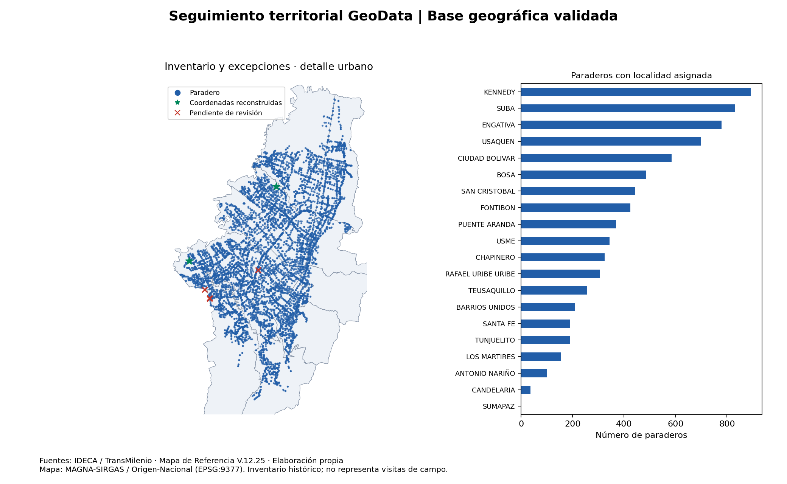

# Seguimiento territorial GeoData

**Base geográfica reproducible para preparar y controlar el seguimiento de paraderos SITP en Bogotá.** Integra inventario, cartografía, reparación de coordenadas, asignación por localidad y trazabilidad de excepciones. Proyecto de portafolio orientado a análisis GeoData y apoyo a operación en campo.

**Pregunta:** ¿cómo transformar capas públicas en un inventario territorial verificable antes de programar inspecciones?

## Resultados verificables

| Indicador | Resultado |
| --- | ---: |
| Paraderos conservados | 7.623 de 7.623 |
| Localidades | 20 |
| Puntos reconstruidos desde atributos de la fuente | 2 |
| Puntos finales válidos y dentro del rango geográfico | 7.623 |
| Paraderos con localidad asignada por intersección | 7.620 |
| Paraderos sin intersección con localidades | 3 |
| Diferencias geometría–atributos superiores a 10 m | 1 |
| Casos pendientes de revisión | 4 |

Los dos puntos tenían coordenadas extremas aunque pasaban la prueba topológica de Shapely. Se repararon únicamente a partir de sus campos de longitud y latitud. Los otros cuatro casos se conservan y se señalan: no se desplazan automáticamente ni se asignan por el texto de la dirección.



Evidencia: [métricas](reports/calidad.json), [bitácora de correcciones](reports/correcciones_geometria.csv), [pendientes](reports/pendientes_revision.csv) y [conteos por localidad](reports/paraderos_por_localidad.csv).

## Alcance actual

Implementado: extracción de capas, validación de identificadores/CRS/coordenadas, reparación de puntos, control topológico de polígonos, cruce espacial, GeoPackage y GeoJSON, mapa, reportes y pruebas. Se entrega un esquema SQL para futuras visitas e incidencias.

**No existen visitas ni incidencias de campo en estos insumos.** No se presentan coberturas de inspección, tiempos de respuesta ni rutas optimizadas como resultados realizados. El inventario corresponde a la copia V.12.25; no se afirma que represente la red actual.

## Estructura

Conserva la organización de los proyectos inmobiliarios del portafolio y añade controles de calidad:

```text
data/README.md            Fuentes, licencia, diccionario y alcance
data/sample/              Extracto versionado: todos los paraderos y localidades
data/processed/           Salidas regenerables, excluidas de Git
src/extract.py            Extracción opcional desde el GeoPackage original
src/pipeline.py           Reparación, cruce, validación y mapa
notebooks/               Recorrido explicativo del análisis
sql/                     Esquema operativo y consultas de calidad
tests/                   Pruebas de regresión y de integración
reports/figures/          Cartografía para el portafolio
docs/                    Metodología, diagnóstico y guion de presentación
.github/workflows/       Validación automática al publicar
.vscode/                 Configuración de ejecución y pruebas
```

## Reproducir en Python

Python 3.12 recomendado. Desde la raíz del repositorio, en PowerShell:

```powershell
python -m venv .venv
.\.venv\Scripts\python.exe -m pip install -r requirements.txt
.\.venv\Scripts\python.exe -m src.pipeline
.\.venv\Scripts\python.exe -m unittest discover -s tests -v
```

En Linux/macOS, sustituir `.\.venv\Scripts\python.exe` por `.venv/bin/python`. Los insumos públicos necesarios están incluidos; no se necesita el archivo original de 4,4 GB, una base remota ni credenciales. Las dependencias se fijaron a las versiones verificadas localmente con Python 3.12 de QGIS 3.44.1.

Salidas locales: `data/processed/base_territorial.gpkg` (capas `paraderos` y `localidades`, EPSG:4686), `paraderos.geojson` y `localidades.geojson` (EPSG:4326), tabla de atributos CSV y reportes. Se pueden abrir las capas en QGIS. El mapa se dibuja en EPSG:9377 y las discrepancias se calculan como distancias geodésicas en metros.

La ejecución puede repetirse sin acumular registros. Si cambia un insumo sin actualizar su manifiesto, el proceso falla deliberadamente.

### Reextraer desde la copia original (opcional)

```powershell
python -m src.extract "RUTA_AL_ARCHIVO/GPKG_MR_V1225.gpkg"
python -m src.pipeline
```

El extractor lee únicamente `PSITP` y `Loca`; no modifica la fuente. Una versión distinta exige revisar la procedencia, actualizar los resultados de referencia y ejecutar las pruebas antes de publicarla.

## Fuentes y uso

Extractos de la copia local del [Mapa de Referencia V.12.25 de IDECA](https://www.ideca.gov.co/node/6476): paraderos de TransMilenio S.A. y localidades incluidas en el paquete distrital. La publicación indica corte general al 30 de diciembre de 2025 y licencia CC BY 4.0. Las fechas internas de cada capa pueden diferir. Las correcciones son de este proyecto, no actualizaciones oficiales ni validaciones en terreno.

Consultar [procedencia y condiciones de los datos](data/README.md), [metodología](docs/METODOLOGIA.md) y [licencia de código](LICENSE). El esquema de visitas es una propuesta para la siguiente fase; los datos de captura real requieren controles adicionales.

## Presentación y publicación

- [Abrir en VS Code y subir a GitHub](PUBLICACION_GITHUB.md).
- [Guion de demostración de tres minutos](docs/GUION_PRESENTACION.md).
- [Diagnóstico original de reutilización de fuentes](docs/VIABILIDAD_DATOS.md).

La configuración de GitHub Actions está preparada. Su ejecución remota solo podrá verificarse después de subir el repositorio.
